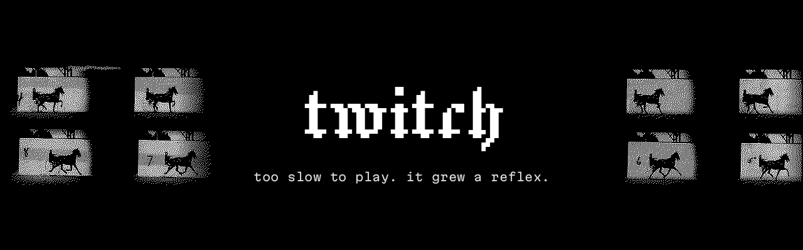
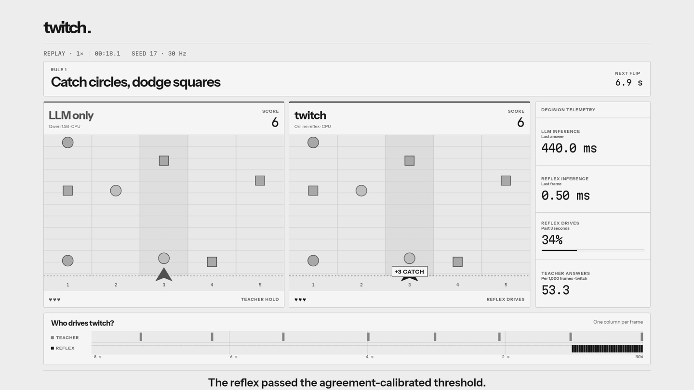
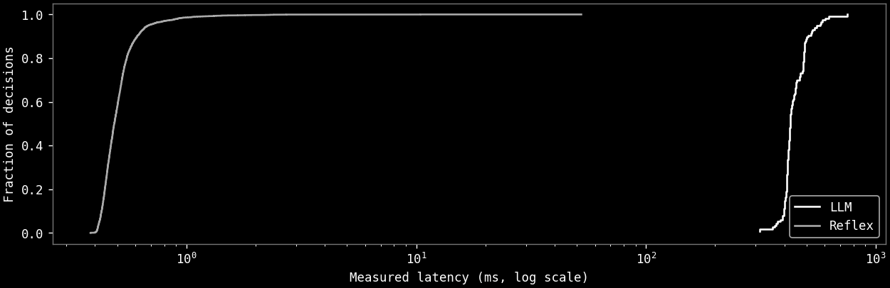
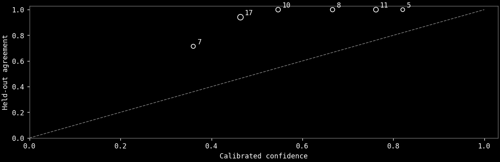
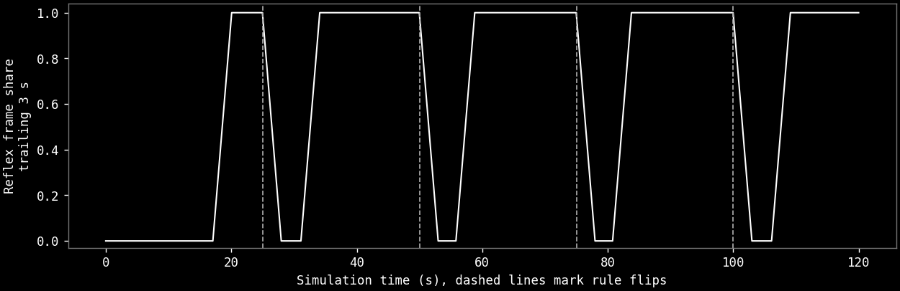
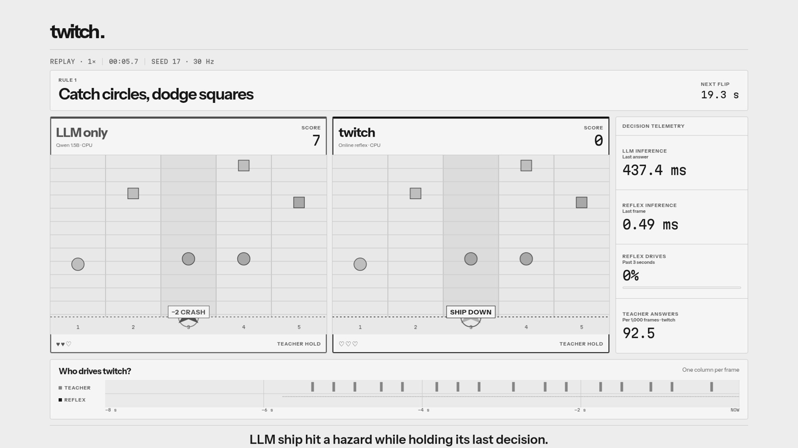
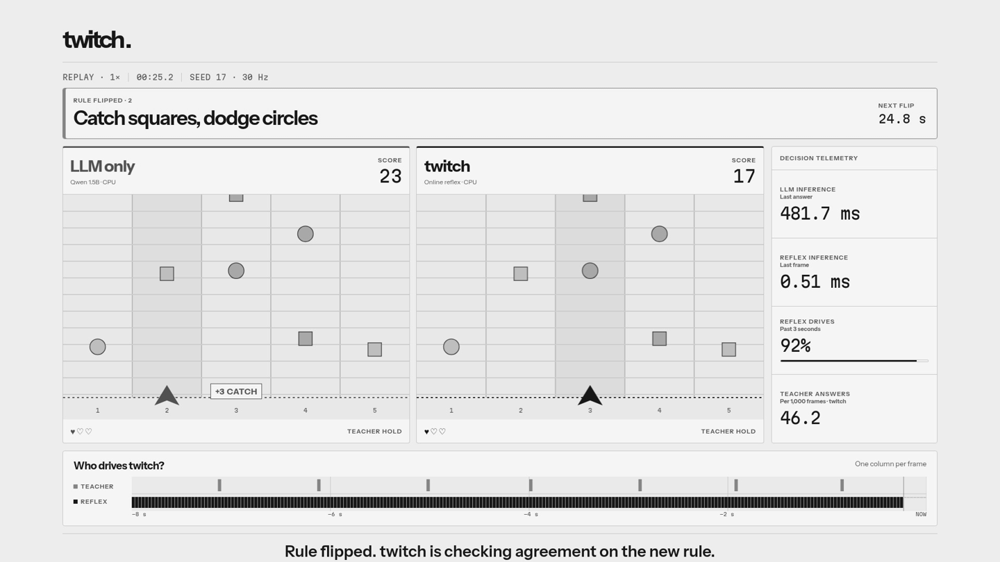
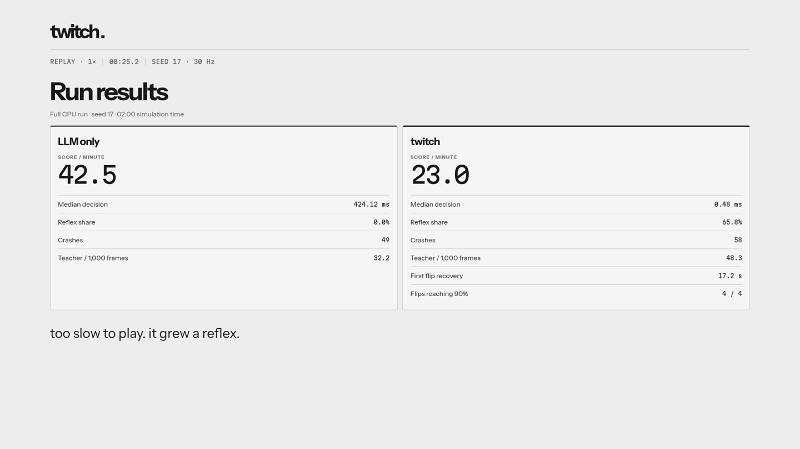
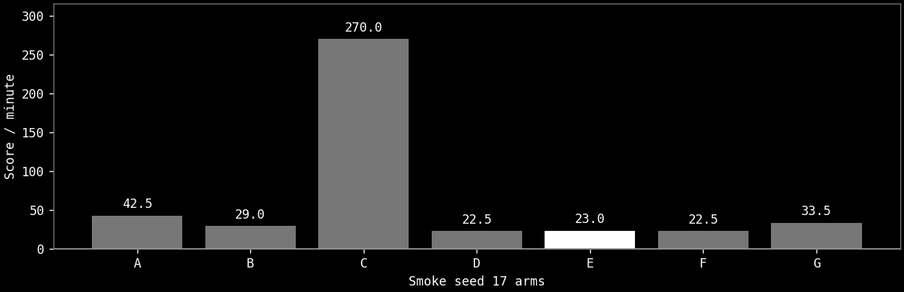
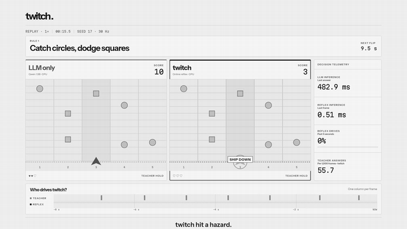

twitch learns to play a 30 Hz lane game from a teacher that answers about old frames.
A small reflex net takes over when its confidence has agreed with the teacher often enough.
Every 25 seconds the rule changes.

`#ai-frontier-research` `#decision-models` `#distillation` `#online-learning` `#game-ai` `#real-time-agents` `#llm-agents` `#continual-learning` `#cpu-inference` `#pytorch`

 



## The Lag

Two ships see the same item stream. Qwen on the left takes one request per second. Between answers, the items fall and the ship holds its last target.



## The Teacher

The teacher sees a frozen text description with the rule and upcoming drops. twitch prioritizes uncertain frames and recent failures for training. Every third answer is held out for an agreement check.



## The Handoff

Graphite marks each frame driven by the reflex. Orange marks a teacher answer arriving. The gap between marks is part of the run.



## The Flip

Circles become hazards and squares become catches. The handoff threshold resets at a rule boundary, and replay gives the new epoch's answers more weight.

| | |
|---|---|
|  |  |
|  |  |

## The Results

Each row is one actual run. Simulation minutes exclude time spent paused in arm B. See the [report](docs/REPORT.md) for the hypothesis tests, confidence intervals, and limits.

In the smoke replay the reflex was fast and took over 65.8% of frames. It scored 23.0 points per minute to the LLM-only ship's 42.5. Nearly all held-out teacher labels said to stay, so high agreement was a weak measure of rule learning.

The timed smoke projects about 7.8 hours for the five-seed CPU matrix. The full hypothesis is pending. The two-minute smoke stops before the fifth flip.



<!-- experiment-table -->

| Run | Arm | Sim. min | Score/min | Reflex % | Median / p95 ms | Teacher / 1k | Wall s |
|---|---|---|---|---|---|---|---|
| smoke-17 | A | 2 | 42.5 | 0.0 | 424.116 / 574.036 | 32.2 | 120.0 |
| smoke-17 | B | 2 | 29.0 | 0.0 | 154.243 / 407.373 | 1000.0 | 639.6 |
| smoke-17 | C | 2 | 270.0 | 0.0 | 0.003 / 0.006 | 0.0 | 0.0 |
| smoke-17 | D | 2 | 22.5 | 100.0 | 0.475 / 1.026 | 84.7 | 120.0 |
| smoke-17 | E | 2 | 23.0 | 65.8 | 0.485 / 0.685 | 48.3 | 120.0 |
| smoke-17 | F | 2 | 22.5 | 0.0 | 1723.256 / 1749.299 | 0.0 | 120.0 |
| smoke-17 | G | 2 | 33.5 | 0.0 | 0.001 / 0.003 | 0.0 | 0.0 |

<!-- experiment-table -->



[16:9 CPU run footage](docs/screenshots/smoke-17-16x9.mp4) · [9:16 footage](docs/screenshots/smoke-17-9x16.mp4) · [Shot list](docs/SHOT_LIST.md)

## Install

```sh
git clone https://github.com/Sebastianrodaaa/twitch.git
cd twitch
python3 -m venv .venv
. .venv/bin/activate
python -m pip install -r requirements.txt
make dry-run
make demo
```

Open `http://127.0.0.1:8000` for the recorded replay. `make repro` rebuilds the run decisions and README table from the recorded teacher answers. These steps use the clone and its virtual environment. Stop the server with Ctrl-C and delete the clone to remove them.

For live mode, `make model` downloads the pinned Qwen Q4_K_M GGUF into `.model/` and checks SHA-256 `6a1a2eb6d15622bf3c96857206351ba97e1af16c30d7a74ee38970e434e9407e`. With CMake and a C++ compiler installed, run `make llama`, then `make teacher` in a second terminal. Use **Live run** once the teacher is listening on port 8081. No API key is required. Delete `.model/` to remove the local weights and build.

For the study, recording, and Beveridge checksum, see the [report](docs/REPORT.md).

## The Name

A twitch is the muscle acting before the thought arrives.

## Inspirations

SwiftSage, DAgger, Beveridge, Decision 1.0, and the [related work](INSPIRATIONS.md).

## License

[MIT](LICENSE). Third-party terms and public-domain art credits are in [NOTICE.md](NOTICE.md).
