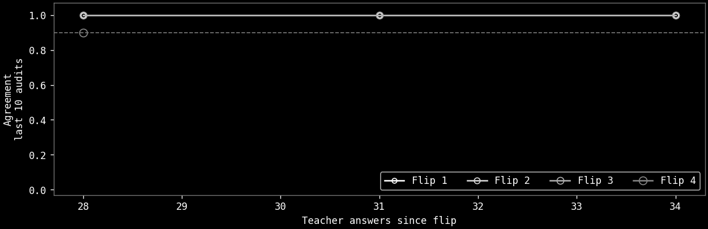

# twitch experiment report

## Method

The environment is a deterministic 30 Hz simulation with five lanes. Each drop has three items in distinct lanes and independent shape and color. Items have variable travel times. A catch is +3 and a collision is −2 and costs a heart. At zero hearts, the ship is out for one simulation second and then respawns. Four rules cycle every 25 seconds. Rule text is given to the teacher and to the rule-aware heuristic. For online calibration and replay, the reflex receives the epoch boundary signal. Its typed network inputs contain lane, cooldown, and the next items' shape, color and time to arrival.

Qwen2.5-1.5B-Instruct Q4_K_M runs through llama.cpp on CPU. The frozen document contains the rule, ship lane, up to two drops and their times. The request shifts the three single-token option logits equally so their relative logprobs are preserved, then normalizes over those options. Clipped off-board motion counts as staying in both execution and agreement. A stale answer is anchored to the position at its query frame. A cross-epoch answer can enter aged replay and cannot issue a new held target. Arm A spaces requests at least one second apart. Online distillation and frozen-reflex audits cap requests at four per second. E has a second cap of 36 dispatched queries per 750-frame epoch. Twelve are available up front and the rest accrue over the epoch. Arm B waits synchronously as simulation time stands still, with one answer per frame and no extra pacing. All inference numbers exclude imposed pacing.

The reflex has 1,019,841 parameters. It scores three destination-centered views together in one forward pass. The CPU learner takes four SGD steps per targeted answer, with a replay buffer of 512 teacher probability vectors and a 25× sampling weight reduction per older epoch, capped at three epochs. An age-bounded heap prioritizes failures and then low-confidence frames. Every third dispatched frame is a current-frame audit. Audits never enter SGD. Per-epoch temperature scaling minimizes audit log loss on a fixed grid. The smallest candidate threshold achieving at least 80% agreement on at least four audit examples opens the handoff, after at least five audit answers. The calibration window holds at most 32 audit examples and is prequential. It estimates agreement under the changing online policy. Arm D is trained on every fourth first-epoch B frame for the same seed and is then frozen. Arm F calls Beveridge's typed choice interface on CPU with the same frozen document and runs asynchronously at its measured throughput. Arm C uses the rule and nearest reachable safe lane at the first drop.

Measure inference latency as wall time in the scoring call for A/B/F and typed encoding plus reflex inference for D/E. For E, Qwen latency and handoff source are also tracked independently. Heuristic and random latency measure local decision time. Slow game ticks are counted at more than one 33.3 ms period late. Recovery is the first within-epoch window of ten held-out audits with at least nine agreements. The reported answer count includes every answer delivered for that epoch through the last audit of that window. A flip that ends without such a window is censored. The separate handoff threshold can reopen before 90% recovery.

The planned study seeds are 17, 29, 43, 59, and 71. The timed seed-17 A/B/E smoke uses two simulation minutes and real Qwen answers. The 10-minute study uses `make study` and skips completed files so it can resume. The report uses 10,000 percentile-bootstrap resamples over flips for the recovery fraction. Flips within a run share a learner, and this interval is descriptive.

## Smoke results

The first real-time smoke comparison returned 42.5 points per minute for A and 23.0 for E. E drove 65.8% of frames with median/p95 reflex inference of 0.485/0.685 ms and 48.3 teacher answers per 1,000 frames. A's median/p95 Qwen inference was 424.116/574.036 ms. E had 19 wipeouts and A had 16. Both arms had zero frame starts more than 33.3 ms behind schedule.

Each of the four flips reached 90% held-out agreement after 28 teacher answers. Recovery times were 17.17, 17.40, 17.10, and 17.10 seconds in order. The percentile bootstrap for the observed recovery-within-40 fraction is 100–100% and the median answer interval is 28–28. Both intervals are degenerate across four flips of one run.

The teacher labeled 57 of 58 held-out E frames “stay.” A constant stay policy would agree on 98.3% of them, and the reflex agreed on 94.8%. This class imbalance explains why the fast handoff and agreement recovery did not establish adaptation to the game rule. E scored 0.54× A in the smoke, below the 2× target. This two-minute run ends before the fifth flip.

The rule-aware heuristic scored 270.0 points per minute without a crash. Random scored 33.5 points per minute and Beveridge scored 22.5. Beveridge delivered 21 decisions in two minutes, with median/p95 CPU inference of 5,295.463/6,532.862 ms. Its median includes concurrent CPU load from the paused smoke run and excludes initial model loading.

Pausing Qwen for every frame yielded 29.0 points per minute, below real-time Qwen's 42.5. The paused arm measures what this teacher does with fresh inputs. It is an imperfect reference for attainable score. Consecutive frozen documents share more of their prompt in B, and the median/p95 latency was 154.243/407.373 ms. The offline frozen reflex scored 22.5 points per minute and agreed with Qwen on all 51 first-flip audits. The smoke missed the predicted drop below 60%.

## Study sizing

The A/E smoke arms each took 120.0 seconds of wall time. B took 639.6 seconds for 3,600 answers. At that rate, five 10-minute B runs take about 4.44 hours. A, D, E and F add 3.33 hours of paced play across five seeds. The unpaced heuristic and random arms each took under 0.04 seconds in the smoke. The resulting estimate is about 7.8 hours for the full CPU matrix, excluding startup and model setup. The estimate is below the 24-hour cutoff, so the default remains five seeds. The results above cover one two-minute seed. The full matrix and post-fifth-flip criteria are pending.

## Social summary

We tested whether a small CPU network could learn a 30 Hz lane game from a language model's delayed judgments. In a two-minute run, the reflex drove 65.8% of frames with about half a millisecond of median inference time. It scored 23.0 points per minute, below the language model's 42.5 and the random baseline's 33.5. Nearly every held-out teacher label said to stay, so recovering teacher agreement told us little about learning the new rules.

## Reproduce

- `python3 test_twitch.py` replays the A/B/E smoke from cached real answers. `make smoke` measures a fresh copy in `.smoke/`. `make repro` rebuilds every recorded run and the README table.
- `python -m pip install -r requirements-research.txt` adds analysis, capture and Beveridge. Beveridge downloads revision `7cb0d24cce8572b8803a738c083b2419cdc40a8a` from Hugging Face. Its `model.safetensors` SHA-256 is `f89e53122b39f0fe17652acc9033c6b3a1fc42b2b9e712d3a678ced82f7f6f44`. Remove that model's Hugging Face cache directory to reclaim the weights.
- `python -m scripts.plots` rebuilds monochrome charts and `python -m scripts.plots --study-summary` calculates run-level ratios and recovery intervals. For footage, install FFmpeg and Playwright Chromium or pass `--chrome /path/to/chrome`. Start `make demo` and see the [shot list](SHOT_LIST.md) for the recorded range. Each output frame comes from the replay page and occupies 1/30 of a second.
- The raw JSON stores targets, driver, reflex latency, confidence, threshold, and frame lag, plus frozen teacher documents, three probabilities, query and delivery tick, and the audit flag. See [results](../results) for logs and [the README](../README.md#the-results) for every run.

## Related work

SwiftSage and DPT-Agent use fast/slow decision layers. ReflexGrad uses progress-gated dual-process recovery. Input prediction hides game inference delay through prediction and correction. Beveridge, Decision 1.0, and System 1 agents study fast typed and local decisions. twitch combines classic policy distillation and DAgger-style learner-state collection with asynchronous frozen-frame labels and measured handoff under rule changes. [References](../INSPIRATIONS.md)
